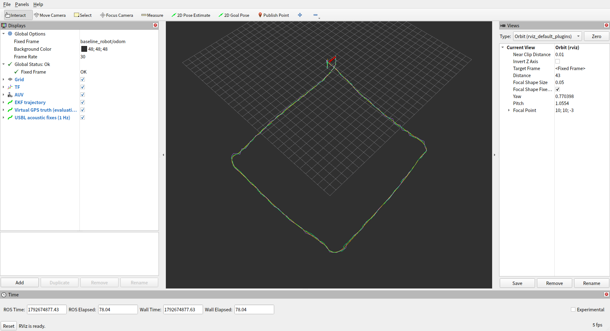
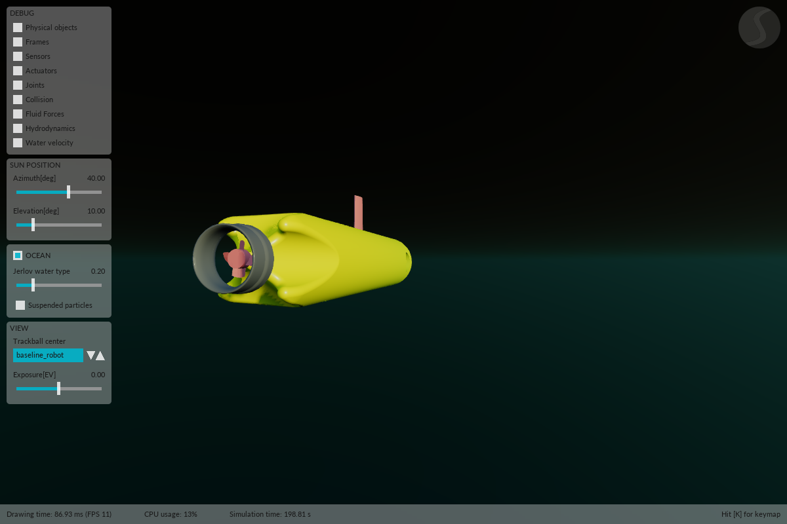
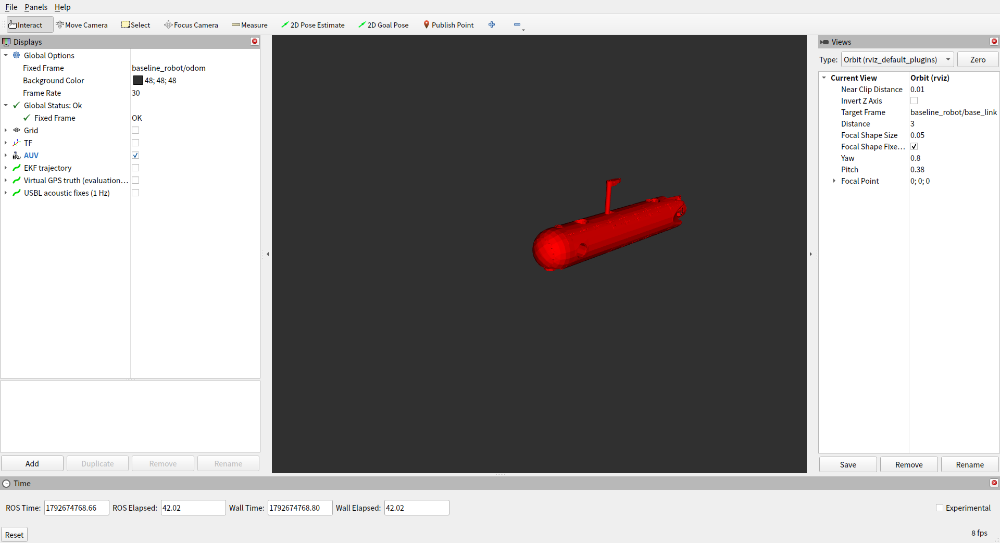
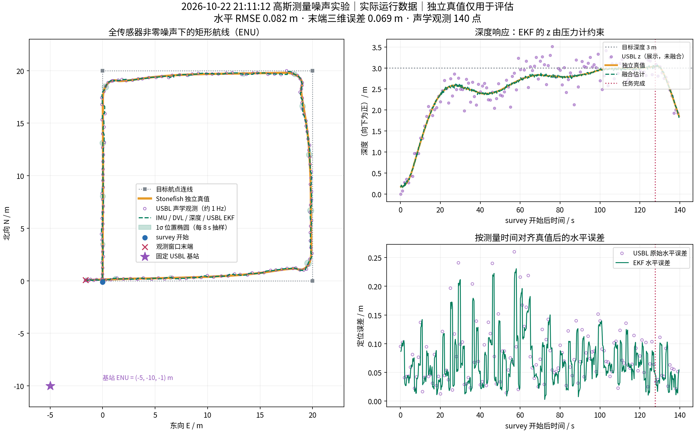
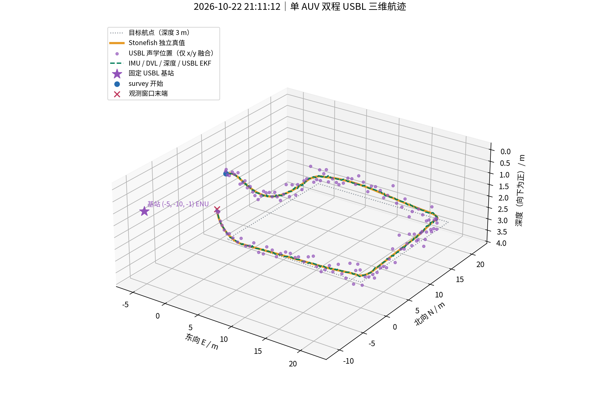
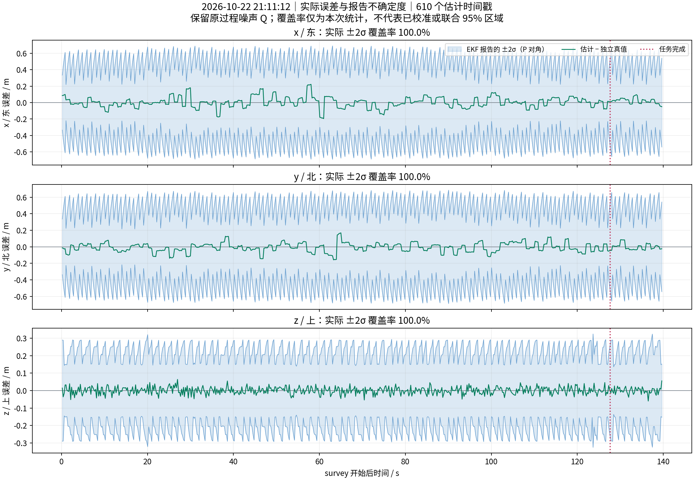
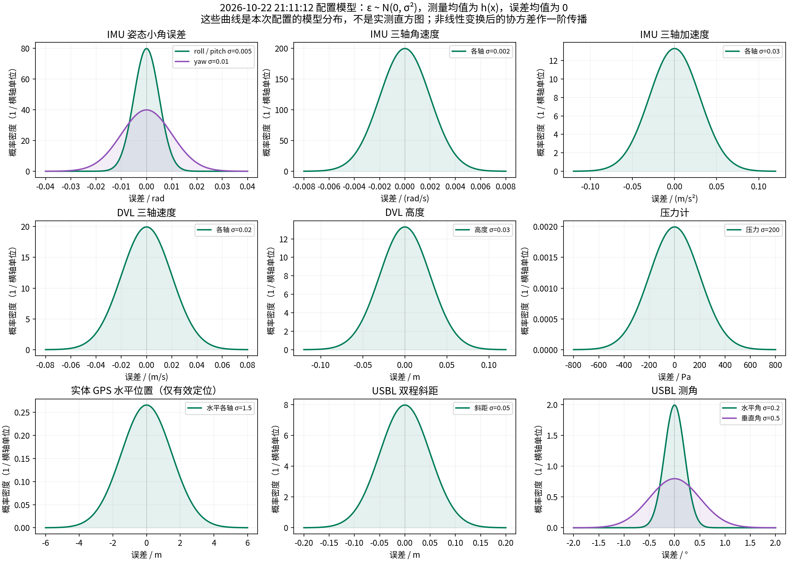
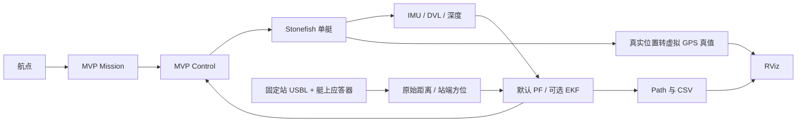

# baseline_robot：从零开始的单 AUV 轨迹控制与组合导航

基于 **ROS 2 Jazzy、Stonefish 和 RViz** 的单 AUV 导航仿真项目。本文已将编译、运行、结果和学习说明统一保存在本 README。

当前只运行一艘 `baseline_robot`：**默认使用论文结构的 `[x,y,yaw]` 粒子滤波（PF），DVL／陀螺预测、固定 USBL 距离／方位校正；深度单独处理，roll/pitch 来自 IMU。虚拟 GPS 仅作独立真值参考**，不参与融合或 world/odom 初始化。项目支持 20 m × 20 m 矩形航点、3 m 目标深度、0.8 m/s 目标航速，提供 RViz 估计/真值轨迹、CSV 保存和时间同步误差评估。

已知位置的固定 USBL 和艇上应答器通过原生 PING/ACK 完成双程测距。默认启用，可用 `use_usbl:=false` 关闭。使用 `localization_filter:=ekf` 可切回原通用 EKF；该 EKF 不是完整的捷联惯导 ESKF。虚拟 GPS 由 Stonefish 独立真实位置生成，在水下仍可作为仿真参考，**不能当作实际水下 GPS**。

## 当前默认 PF（2026-10-23）

依据 Weng et al. (2024), [JFR, DOI: 10.1002/rob.22348](https://doi.org/10.1002/rob.22348) 第 3.2 节改造组合导航。**只迁移导航结构，不包含论文的 SAC 或光链路对准控制**。本项目采用固定基站，方位测量不显式包含艇体航向；该几何差异已在模型中处理。

```bash
source scripts/env.sh
colcon build --packages-select baseline_robot_bringup --symlink-install
source scripts/env.sh
ros2 launch baseline_robot_bringup bringup_simulation.launch.py
# EKF 对照：在启动命令后添加 localization_filter:=ekf
# 关闭声学：在启动命令后添加 use_usbl:=false
```

默认 2,000 粒子、20 Hz 输出、2 秒历史回放；保留 `odometry/filtered` 和 `odom -> base_link` 接口。RViz 可添加 PoseArray `/baseline_robot/navigation/particles`；诊断位于 `/baseline_robot/navigation/pf_diagnostics`。

参数、论文公式对应关系、深度与协方差近似、固定站适配和复跑方法见 [PF 导航说明](docs/particle_filter_navigation.md)。**下文所有 2026-10-22 的截图、精度、噪声验收与结果均属于原 EKF 历史运行，不能当作 PF 的实验结果。**

已完成 74 项 Python 测试及含/不含 USBL 的完整矩形航线。最终含 USBL 运行约 127.5 秒完成全部航点，水平 RMSE **0.04450 m**、最大三维误差 **0.12324 m**、末端三维误差 **0.04198 m**，三项验收通过，所有节点正常退出；关闭 USBL 的独立运行水平 RMSE **0.13858 m**。两组实际输出均约 20 Hz。[指标、耗时和验证边界](docs/particle_filter_navigation.md#2026-10-23-实际验证记录)及[原始验证汇总](results/2026-10-23-paper-pf-validation/validation_summary.json)已保存。


## 全部图片重新生成（2026-10-22 21:11 重跑）

已删除 `assets/` 中原有的全部图片，并用本次运行重新生成 **7 张图片**：RViz 完整航线、Stonefish 机器人外形、RViz 模型近景、二维轨迹、三维轨迹、误差与 ±2σ、配置噪声分布。前三张是实际窗口截图；轨迹和误差图使用同一运行的数据，噪声分布图明确展示配置模型。完整记录保存在 [results/2026-10-22-refresh-211112](results/2026-10-22-refresh-211112/mission.json)。

本次保持传感器噪声、单 EKF 输入与过程噪声 Q 不变，完成全部四个矩形航点，约 **127.6 秒**后返回 `start`，继续观测 12 秒后关闭控制器并正常退出。

**RViz 完整航线**：`Global Status: Ok`，绿色为融合估计，橙色为独立真值，紫色为 USBL 声学位置连线；左侧开启 AUV、TF 和三条 Path。总览视距为 43 m，固定坐标系是 `baseline_robot/odom`。



**Stonefish 机器人外形**：新拍摄的黄色 AUV、艇身及尾部导管推进器。`Trackball center` 选择 `baseline_robot`；滚轮缩放、拖动旋转。截图时隐藏悬浮颗粒以看清外形。



**RViz 模型近景**：当前 URDF/STL 的红色渲染；视图跟随 `baseline_robot/base_link`，视距 3 m，临时隐藏其他显示以观察模型。



三张截图在独立 X11 显示中实际运行程序后取得，使用 Mesa 软件渲染；图中 FPS 是显示帧率，传感器频率见任务记录。[截图来源与时间](results/2026-10-22-refresh-211112/screenshots.jsonl)、[截图脚本](results/2026-10-22-refresh-211112/capture_ui.py)、[近景配置](results/2026-10-22-refresh-211112/rviz-model.rviz)、[启动与退出日志](results/2026-10-22-refresh-211112/launch.log)均已保存。全部新 PNG 的同份原始文件还保存在本次结果目录的 `images/` 中。

日常打开同样界面：

```bash
source scripts/env.sh
ros2 launch baseline_robot_bringup bringup_simulation.launch.py localization_filter:=ekf use_usbl:=true rviz:=true
```

执行完整航点任务的方法见第 4 节。查看近景时在 RViz 的 `Views` 中将 `Target Frame` 改为 `baseline_robot/base_link`、`Distance` 设为约 3 m；查看全航线时使用默认总览配置。

## 本次完整航线与不确定度实测（2026-10-22 21:11）

当前 IMU、DVL、压力、实体 GPS 和 USBL 均配置了非零测量噪声，有效测量同时携带数值和协方差。已执行全部四个矩形航点，日志确认 `Done with all waypoints`，约 **127.6 秒**后返回 `start`，继续观测 12 秒后关闭控制器，所有仿真节点正常退出。本次重新验证完整航线与测量方差，沿用已有通过回归的代码。

下图使用本次实际运行的数据：绿色是融合估计，橙色是独立真值，紫色是实际 USBL 观测，浅绿色是每 8 秒抽样的 **1σ 位置椭圆**。椭圆使用 EKF 的完整水平位置协方差，未放大；二维 1σ 椭圆并非 68% 或 95% 的联合置信区域。USBL 仅将 x/y 加入 EKF，z 散点仅展示，融合深度仍由压力计约束。



三维图使用相同运行和相同时间窗，深度轴向下为正；任务完成后控制状态切换，艇开始回升。



统计窗口为 **survey 开始至任务完成后 12 秒**。612 个真值时间戳用于 RMSE：将估计线性插值到真值时间，不做事后平移或旋转对齐。窗口包含 **140 个声学观测**。

| 指标 | 本次实测 | 预设验收阈值 |
|---|---:|---:|
| 水平 RMSE | 0.082387 m | < 0.30 m |
| 三维 RMSE | 0.084692 m | < 0.35 m |
| 最大三维误差 | 0.232303 m | 记录值 |
| 末端三维误差 | 0.069466 m | < 0.35 m |
| 三项阈值检查 | **全部通过** | `--profile usbl --check` 返回 0 |

误差与不确定度图使用另外 **610 个估计时间戳**：将独立真值插值到估计时刻，并使用该时刻原始报告的 `P`，不插值协方差。两种统计的时间窗相同，采样时刻不同。



| 轴 | 实际 ±2σ 覆盖率 | 平均报告 σ |
|---|---:|---:|
| x / 东 | 100.0% | 0.24677 m |
| y / 北 | 100.0% | 0.24455 m |
| z / 上 | 100.0% | 0.11168 m |

**这些覆盖率不表示不确定度已经校准。** 本次报告区间相对实际误差偏宽；保留的通用过程噪声 Q、预测与测量更新周期、额外声学位置预算都会影响 P，图中的锯齿反映了这些更新。这里只报告单次运行的各轴边际覆盖率，不把它解释为联合 95% 覆盖率。参数属于仿真示例，尚无固定偏置、随机漂移或海流模型。

### 测量的均值、分布和协方差

原始通道采用独立高斯模型：

\[
z_t=h(x_t)+\epsilon_t,\qquad \epsilon_t\sim\mathcal N(0,R),\qquad R=\operatorname{diag}(\sigma_i^2).
\]

`h(x_t)` 是给定真实状态时的理想测量均值，`z_t` 是一次带噪观测；消息中的数值与协方差共同描述滤波输入，协方差不是另一个需要叠加的随机数。误差均值为 0，不代表测量值本身均值为 0。Stonefish 原生生成一次噪声，适配器只做单位、坐标和协方差传播；不重复加噪。姿态的方差描述小角度误差，而不是四元数四个分量的独立高斯分布。

| 测量通道 | 示例标准差 σ | 原始方差 σ² / 有效范围 |
|---|---|---|
| IMU roll / pitch / yaw | `[0.005, 0.005, 0.010] rad` | `[2.5e-5, 2.5e-5, 1e-4] rad²` |
| IMU 三轴角速度 | 各 `0.002 rad/s` | 各 `4e-6 (rad/s)²` |
| IMU 三轴加速度 | 各 `0.03 m/s²` | 各 `9e-4 (m/s²)²` |
| DVL 三轴速度 | 各 `0.02 m/s` | 各 `4e-4 (m/s)²` |
| DVL 高度 | `0.03 m` | `9e-4 m²` |
| 压力 | `200 Pa` | `40000 Pa²`；深度 σ 约 `0.01993 m` |
| 实体 GPS 水平位置 | 各 `1.5 m` | 各 `2.25 m²`，仅定位有效时；高程不支持 |
| USBL 距离 | `0.05 m` | `0.0025 m²` |
| USBL 水平角 / 垂直角 | `0.2° / 0.5°` | 换算为弧度后平方，约 `1.218e-5 / 7.615e-5 rad²` |

下图是从本次记录的配置元数据画出的**模型分布**，不是传感器实测直方图。上面的轨迹、误差和覆盖率图则全部来自真实运行记录。



场景 `.scn` 是原始噪声参数来源，测试核对 `usbl.yaml` 和 DVL 高度适配参数中的重复配置。深度方差包含 `Var(P)/(ρg)²` 和姿态杆臂项；USBL 通过球坐标雅可比及基站旋转传播完整协方差，因此变换后的分量可以相关。非线性变换后的高斯描述是一阶近似。USBL 距离和角度分辨率均为 **0**，关闭截断量化；另保留 `0.01 m² × I` 的位置模型/时间误差预算，它不属于原生噪声，也没有在仿真中再次生成随机误差。

测量噪声 **R** 描述观测误差，过程噪声 **Q** 描述状态预测误差。本次保持单 EKF、全部输入选择和原有 15×15 Q 不变。独立 ground truth 及其虚拟 GPS 参考保持理想值，只用于评估。实体 GPS 在水下报告失锁，`altitude=0` 不代表有效高程；所有 GPS 均未送入 EKF。未测量的姿态、速度等占位字段不作为观测，是否融合由输入掩码明确限定。

### 数据、复算与重跑

CSV 保持原有列顺序，末尾追加 `cov_xx,cov_xy,cov_xz,cov_yy,cov_yz,cov_zz`，单位 m²；旧 CSV 仍可计算原定位指标。自动生成同名 `-sensors.jsonl`，首行保存模型，后续保留原始消息、协方差、时间戳和有效性标记。USBL 原消息没有协方差字段，JSONL 额外保存距离/水平角/垂直角的原始方差，转换后位置另有完整协方差。DVL 新增 `/baseline_robot/dvl/altitude_with_covariance`，保留原高度话题，详见第 7 节。

本次核对了整份 JSONL：全部有效 IMU、DVL、压力和实体 GPS 水平方差与配置一致，深度及 USBL 的传播方差为有限正数，**方差不匹配数为 0**。共记录 199 条实体 GPS，其中 175 条失锁并标为无效，均未参与融合。零方差/未知方差、非有限、失锁及 DVL/压力裁剪边界均有拒绝或有效性检查；本次没有遇到 DVL 或压力裁剪样本。

- [本次轨迹与协方差 CSV](results/2026-10-22-refresh-211112/trajectory.csv)、[完整传感器 JSONL](results/2026-10-22-refresh-211112/trajectory-sensors.jsonl)。
- [定位指标](results/2026-10-22-refresh-211112/metrics.json)、[覆盖率与逐传感器方差核对](results/2026-10-22-refresh-211112/uncertainty.json)、[任务与频率](results/2026-10-22-refresh-211112/mission.json)、[绘图窗口与数量](results/2026-10-22-refresh-211112/recording.json)。
- [EKF 实际订阅](results/2026-10-22-refresh-211112/ekf-node.txt)、[启动及退出日志](results/2026-10-22-refresh-211112/launch.log)、[四航点任务日志](results/2026-10-22-refresh-211112/mission.log)。
- [既有 49 项 pytest 记录](results/2026-10-22-gaussian/test.log)、[既有构建记录](results/2026-10-22-gaussian/build.log)、[既有 CTest 汇总](results/2026-10-22-gaussian/test-result.log)。
- [本次配置快照](results/2026-10-22-refresh-211112/configuration/scenarios/baseline_robot.scn)、[声学场景快照](results/2026-10-22-refresh-211112/configuration/scenarios/single_auv.scn)、[EKF 配置快照](results/2026-10-22-refresh-211112/configuration/config/baseline_robot/localization.yaml)、[文件校验与退出检查](results/2026-10-22-refresh-211112/verification.json)。
- [二维 SVG](results/2026-10-22-refresh-211112/navigation-results.svg)、[三维 SVG](results/2026-10-22-refresh-211112/usbl-trajectory-3d.svg)、[误差与 ±2σ SVG](results/2026-10-22-refresh-211112/position-uncertainty.svg)、[配置分布 SVG](results/2026-10-22-refresh-211112/sensor-noise-models.svg)。

复算同一时间窗并重画四张结果图，再同步本次七张图片（绘图需要 `matplotlib`、`numpy`、`fontconfig` 和 Noto CJK 字体）：

```bash
source scripts/env.sh
ros2 run baseline_robot_bringup evaluate_navigation.py \
  results/2026-10-22-refresh-211112/trajectory.csv --profile usbl --check \
  --start-time 1792674716.7931979 --end-time 1792674856.44436 \
  --json results/2026-10-22-refresh-211112/metrics.json
ros2 run baseline_robot_bringup evaluate_uncertainty.py \
  results/2026-10-22-refresh-211112/trajectory.csv --check \
  --start-time 1792674716.7931979 --end-time 1792674856.44436 \
  --json results/2026-10-22-refresh-211112/uncertainty.json
python3 results/2026-10-22-refresh-211112/plot_results.py
cp results/2026-10-22-refresh-211112/images/*.png assets/
```

本次使用隔离的 `ROS_DOMAIN_ID=95`，`rviz:=true`；结果图由运行数据绘制。Stonefish 海面着色器仍报告 `Failed to link program!`，未阻止传感器或完整任务。重新运行时，两终端加载相同环境并使用相同 domain。终端 A：

```bash
source scripts/env.sh
export ROS_DOMAIN_ID=95
ros2 launch baseline_robot_bringup bringup_simulation.launch.py \
  use_usbl:=true rviz:=true csv_path:=/tmp/baseline_gaussian_trial_02/trajectory.csv
```

终端 B：

```bash
source scripts/env.sh
export ROS_DOMAIN_ID=95
python3 results/2026-10-22/run_survey.py --output-dir /tmp/baseline_gaussian_trial_02
```

CSV 和任务结果使用尚未存在的新文件名，避免覆盖已有实验。任务脚本结束后，在终端 A 按 Ctrl+C 正常退出仿真。日常使用可保留默认 domain。更改测量噪声后重新编译并启动，随机噪声下每次轨迹和指标会有差异。

<details>
<summary>本次刷新前的高斯噪声与界面运行记录（历史参考）</summary>

上一轮高斯实验的水平 RMSE 为 0.093987 m，数据保留在 [轨迹 CSV](results/2026-10-22-gaussian/trajectory.csv)、[指标](results/2026-10-22-gaussian/metrics.json)、[不确定度统计](results/2026-10-22-gaussian/uncertainty.json)、[二维 SVG](results/2026-10-22-gaussian/navigation-results.svg) 和 [三维 SVG](results/2026-10-22-gaussian/usbl-trajectory-3d.svg)。此前界面演示的 [任务记录](results/2026-10-22-gaussian-ui-render/mission.json) 和 [日志](results/2026-10-22-gaussian-ui-render/launch.log) 也保留为历史参考。旧的 `assets/` 图片已全部移除；历史绘图脚本现在只写入自己的实验目录。

</details>

<details>
<summary>全传感器噪声更新前的 USBL 实验（历史参考）</summary>

此前 IMU/DVL 近零噪声，USBL 启用测距/测角噪声及旧的截断分辨率；不能与当前运行直接比较抗噪性能。历史完整航线水平 RMSE 为 0.110425 m，末端三维误差为 0.076960 m。历史数据与图片全部保留：

- [轨迹 CSV](results/2026-10-22-usbl-visual/trajectory.csv)、[指标](results/2026-10-22-usbl-visual/metrics.json)、[任务记录](results/2026-10-22-usbl-visual/mission.json)、[绘图脚本](results/2026-10-22-usbl-visual/plot_results.py)。
- [历史二维图](results/2026-10-22-usbl-visual/navigation-results.png)、[历史三维图](results/2026-10-22-usbl-visual/usbl-trajectory-3d.png)。历史绘图脚本只更新自己的目录，不覆盖最新图片。
- [首次 USBL 验证](results/2026-10-22-usbl/metrics.json)。

</details>

<details>
<summary>接入前的基线数据（历史参考）</summary>

**USBL 接入前的基线结果（2026-10-22）**

本节数据保留自 IMU/DVL/深度基线，**不包含新增 USBL**；历史场景使用近零测量噪声；仅添加 `use_usbl:=false` 不会恢复旧噪声配置。声学融合结果与说明见第 8 节。

在不加载旧工作空间的情况下，已重新构建 **11 个依赖包和本项目 4 个包**；17 项 pytest 传感器回归全部通过。实际启动 Stonefish、RViz、EKF 和控制/任务节点，执行全部四个矩形航点，日志确认 `Done with all waypoints`，约 **127.2 秒**后自动返回 `start`，继续观测 12 秒并关闭控制器。验证结束后 SIGINT 退出，仿真与 ROS 节点均正常结束。

下表只统计 **survey 开始至任务完成后 12 秒**，共 638 个时间同步样本。估计位置线性插值到真值时间戳，统一使用艇体原点的 ENU 表示，不做事后平移或旋转对齐。

| 指标 | 本次实测 | 历史近零噪声场景阈值 |
|---|---:|---:|
| 水平 RMSE | 0.008412 m | < 0.10 m |
| 三维 RMSE | 0.008418 m | < 0.15 m |
| 最大三维误差 | 0.014682 m | 记录值 |
| 末端三维误差 | 0.006777 m | < 0.10 m |
| 三项阈值检查 | **全部通过** | `--check` 返回 0 |

IMU、EKF 和本地真值实测约 20 Hz，DVL/深度约 5 Hz，虚拟 GPS 经纬高约 0.97 Hz。实际节点订阅也确认 EKF 只接收 IMU、DVL 与深度，GPS 真值节点不订阅 EKF。此结果仅适用于当时近零噪声、无海流场景；定位误差和航点/深度跟踪误差是不同指标，不能用毫米级估计误差证明真实环境中的导航或控制精度。

原先的基线图片和旧界面截图已按本次要求从 `assets/` 删除；历史数值与原始实验数据继续保留，当前图片统一见本文顶部。

本次启动日志中 Stonefish 海面着色器有两条 `Failed to link program!`，未阻止单艇模型、水下场景、传感器和完整航点任务运行；海面渲染仍有兼容性限制。本次未修改系统 Stonefish 核心库。

原始数据与证据：

- [轨迹 CSV](results/2026-10-22/trajectory.csv)、[航线窗口指标](results/2026-10-22/metrics.json)、[任务完成与频率记录](results/2026-10-22/mission.json)。
- [依赖构建日志](results/2026-10-22/dependencies-build.log)、[四包构建日志](results/2026-10-22/build.log)、[pytest 日志](results/2026-10-22/test.log)、[测试汇总](results/2026-10-22/test-result.log)。
- [完整启动与退出日志](results/2026-10-22/launch.log)、[任务日志](results/2026-10-22/mission.log)、[话题及类型](results/2026-10-22/topics.txt)、[EKF 实际订阅](results/2026-10-22/ekf-node.txt)、[真值节点实际订阅](results/2026-10-22/gps-truth-node.txt)。

原始 CSV 还包含启动和截图期间的额外观测；整份 CSV 排除启动前 5 秒的结果单独保存在 [full-metrics.json](results/2026-10-22/full-metrics.json)。复算上表并重画结果图：

```bash
source scripts/env.sh
ros2 run baseline_robot_bringup evaluate_navigation.py \
  results/2026-10-22/trajectory.csv \
  --start-time 1792649968.8630674 --end-time 1792650108.0654294 \
  --check --json /tmp/baseline_metrics.json
python3 results/2026-10-22/plot_results.py
```

重画结果图需要 Python `matplotlib`、`numpy`、`fontconfig` 和 Noto CJK 字体。本次运行使用隔离的 `ROS_DOMAIN_ID=84`；重做验证时，启动终端和任务终端都执行 `export ROS_DOMAIN_ID=84`，指定新的 CSV 文件；另一个终端加载环境后运行 `python3 results/2026-10-22/run_survey.py --output-dir /tmp/baseline_trial_02`。该[自动 survey 验证脚本](results/2026-10-22/run_survey.py)会把新任务的 `mission.json` 保存到指定目录，并拒绝覆盖已有结果。日常手动运行可使用系统默认 domain，所有终端保持一致即可。


</details>

## 项目目录

```text
baseline_robot/
├── baseline_robot/               # 项目基础包
├── baseline_robot_bringup/       # launch、传感器参数、场景与辅助节点
│   ├── launch/                   # 仿真、定位、控制、任务和可视化
│   ├── config/baseline_robot/    # 航点、EKF 与驱动参数
│   ├── scenarios/               # 单艇世界和动力学模型
│   └── scripts/                 # 传感器适配、虚拟 GPS、轨迹与评估
├── baseline_robot_config/        # MVP 控制与任务状态配置
├── baseline_robot_description/   # URDF、网格、RViz
├── scripts/                      # 环境、依赖构建脚本、版本清单与补丁
├── assets/                       # 本次运行截图与结果图
├── results/                     # 历史实验与最新全传感器高斯噪声运行数据
├── .deps -> ~/.cache/baseline_robot/dependencies  # 忽略的依赖缓存
└── readme.md                     # 完整中文入门与运行文档
```

本项目保持四个 ROS 包。`build/`、`install/`、`log/` 是自动生成的构建产物，`.deps` 是外部依赖缓存，均不提交到版本库。原 `docs` 内容已并入本文，截图和实测数据放在 `assets/`、`results/`。

## 1. 先分清谁负责什么

| 名称 | 你可以怎样理解 | 在本项目中的作用 |
|---|---|---|
| ROS 2 | 各程序交换数据的总线 | 节点、话题、服务、消息 |
| Stonefish | 虚拟水池和虚拟传感器 | 算水动力、推进器、艇的真实运动和传感器测量 |
| RViz | 数据观察窗口 | 显示模型、坐标系、估计轨迹；不负责水动力 |
| IMU / INS | IMU 测角速度和加速度；INS 是用这些量解算姿态、速度和位置的系统 | 默认 PF 使用姿态与角速度，不积分加速度 |
| DVL | 测艇相对海底或水体的速度 | 约束速度，减缓惯性积分漂移 |
| 深度计 | 测水压并换算深度 | 约束垂直位置 |
| USBL | 通过声学距离和角度提供相对位置观测 | 已知位置的固定基站提供水平绝对位置约束 |
| Paper PF / robot_localization | 论文结构 PF / 原 EKF 对照 | 由启动参数二选一，发布 `/baseline_robot/odometry/filtered` |
| MVP Mission / Control | “往哪走”和“推进器怎么转” | 航点引导和闭环控制 |

三个轨迹别混淆：**参考轨迹**是你想让艇经过的航点；**真值轨迹**是从 Stonefish 实际位置生成的无噪声虚拟 GPS 参考；**估计轨迹**是滤波器仅凭传感器推算的位置。评估定位应比较估计与真值，而不是只比较估计与航点。



## 2. 认识文件：先看这几个就够了

以下路径相对于本仓库根目录。

| 文件 | 学什么、改什么 |
|---|---|
| `baseline_robot_bringup/launch/bringup_simulation.launch.py` | 总启动入口 |
| `baseline_robot_bringup/scenarios/single_auv.scn` | 水环境、只生成一艘艇、30 m 深海底 |
| `baseline_robot_bringup/scenarios/baseline_robot.scn` | 艇、推进器、传感器、采样频率和噪声 |
| `baseline_robot_bringup/config/baseline_robot/bhv_params.yaml` | 航点和速度 |
| `baseline_robot_config/mvp_mission_config/baseline_robot/helm.yaml` | start / survey 等任务状态 |
| `baseline_robot_bringup/config/baseline_robot/localization.yaml` | EKF 使用哪些传感器 |
| `baseline_robot_bringup/config/baseline_robot/particle_filter.yaml` | 默认 PF 的粒子数、噪声、超时和回放配置 |
| `baseline_robot_bringup/scripts/particle_filter_core.py` | 论文 PF 的运动学、声学评分、重采样和可复现回放 |
| `baseline_robot_bringup/scripts/particle_filter_node.py` | ROS 传感器、固定站模型、里程计、TF、粒子云和诊断 |
| `baseline_robot_bringup/scripts/usbl_adapter.py` | 固定站声学测量转 ENU 艇位，传播协方差并补偿延迟 |
| `baseline_robot_bringup/config/baseline_robot/usbl.yaml` | 已知基站位姿、声速、量程、噪声与分辨率 |
| `baseline_robot_bringup/config/baseline_robot/sim_params.yaml` | 传感器驱动和推进器话题 |
| `baseline_robot_description/urdf/baseline_robot/base.urdf` | ROS 模型和传感器安装坐标系 |
| `baseline_robot_description/config/config.rviz` | RViz 默认显示配置 |
| `baseline_robot_bringup/scripts/gps_truth.py` | 从独立真实位置生成虚拟 GPS 经纬高和 ENU 真值；不读 EKF 输出 |
| `baseline_robot_bringup/config/baseline_robot/gps_truth.yaml` | 固定经纬度原点，须与场景 `<ned>` 一致 |
| `baseline_robot_bringup/scripts/navigation_path.py` | 收集定位输出和真值，发布轨迹并保存 CSV |
| `baseline_robot_bringup/scripts/sensor_uncertainty.py` | 记录原始传感器消息、协方差、有效性和场景噪声模型 |
| `baseline_robot_bringup/scripts/evaluate_uncertainty.py` | 核对测量方差并报告各轴 ±2σ 实际覆盖率 |

`.scn` 定义仿真里的实体；URDF 定义 ROS 看到的模型与坐标关系。改传感器安装位置时要同时检查两者，不能只改 RViz 模型。

## 3. 从依赖准备到编译启动

本机运行环境为 **Ubuntu 24.04、ROS 2 Jazzy、Stonefish 1.6.0、robot_localization 3.8.3**。需要可用的桌面/OpenGL 环境，`rviz:=false` 仍会启动 Stonefish 图形窗口。

| 依赖 | 用途 / 来源 |
|---|---|
| ROS 2 Jazzy | [ROS 官方安装与教程](https://docs.ros.org/en/jazzy/)；本机位于 `/opt/ros/jazzy` |
| Stonefish 1.6.0 | [水下动力学仿真库](https://github.com/patrykcieslak/stonefish)；本机已安装到 `/usr/local` |
| stonefish_ros2 | [ROS 2 仿真接口](https://github.com/patrykcieslak/stonefish_ros2) |
| world_of_stonefish | [共享网格、材质与传感器驱动](https://github.com/GSO-soslab/world_of_stonefish) |
| robot_localization | [IMU/DVL/深度 EKF](https://github.com/cra-ros-pkg/robot_localization) |
| MVP | [控制器](https://github.com/uri-ocean-robotics/mvp_control)、[任务与行为](https://github.com/uri-ocean-robotics/mvp_mission)、[消息](https://github.com/uri-ocean-robotics/mvp_msgs)、[定位工具](https://github.com/uri-ocean-robotics/mvp_utilities) |
| acomms_msgs | [现有声学驱动依赖的消息](https://github.com/GSO-soslab/acomms_msgs) |

### 3.1 准备依赖（本机已完成）

项目通过 `.deps` 加载独立依赖，不再加载已删除的旧工作空间。`.deps` 链接到英文缓存路径 `~/.cache/baseline_robot/dependencies`，用于避免本机 ROS 消息生成器在中文构建路径下截断 IDL 文件名。源码、构建结果和解包的二进制依赖均放在这个缓存中；清空缓存后需重新准备依赖。

```bash
cd ~/桌面/baseline_robot
bash scripts/build_dependencies.sh
```

脚本按 `scripts/dependencies.repos` 的提交版本准备源码、应用 `scripts/dependency_patches/` 中已有的 Jazzy/Stonefish 兼容补丁，再编译所需的 11 个依赖包。`scripts/debian_dependencies.json` 记录本次使用的 Debian 包版本；缺少缓存时脚本通过本机 APT 软件源下载并解包到 `.deps/root`，无需管理员权限，不修改系统安装。初次准备需要联网、Git、Python YAML 和可用的 ROS/Ubuntu 软件源；锁定版本不可下载时会明确失败，需要准备对应包或按新环境更新版本清单。

**该脚本的前提**是已经按上游说明安装 ROS 2 Jazzy、Stonefish 1.6.0 及其开发依赖（包括 PCL、SDL2、Freetype、Eigen、Boost、yaml-cpp 等）。它不负责安装操作系统、ROS 基础环境或 Stonefish 核心库。本机保留了这些系统依赖，已重新构建上述 11 个 ROS 依赖包。

### 3.2 编译本项目

每个新终端都先进入仓库并加载环境：

```bash
cd ~/桌面/baseline_robot
source scripts/env.sh
colcon build --symlink-install --packages-select \
  baseline_robot baseline_robot_description \
  baseline_robot_config baseline_robot_bringup
source scripts/env.sh
ros2 pkg prefix baseline_robot_bringup
```

最后一条必须指向当前仓库的 `install/baseline_robot_bringup`。`scripts/env.sh` 按 ROS 系统环境 → 本项目依赖 → 本项目四个包的顺序加载。不要加载已删除工作空间的 setup 文件；重新编译前若保留了旧缓存，应先移走本项目旧 `build/` 与 `install/` 再构建。

运行传感器回归检查：

```bash
colcon test --packages-select baseline_robot_bringup
colcon test-result --verbose
```

### 3.3 启动 Stonefish 与 RViz

终端 A：

```bash
cd ~/桌面/baseline_robot
source scripts/env.sh
ros2 launch baseline_robot_bringup bringup_simulation.launch.py
```

应出现 Stonefish 和 RViz 两个窗口。约 5 秒后启动控制器、10 秒后启动任务节点。**默认不自动执行航点**，先检查数据，再切换 `survey`。

| 启动参数 | 默认值 | 含义 |
|---|---|---|
| `rviz` | `true` | 是否打开 RViz |
| `localization_filter` | `pf` | `pf` 论文结构粒子滤波／`ekf` 原 EKF 对照 |
| `use_usbl` | `true` | PF 融合原始声学距离/方位；EKF 融合适配后的 x/y |
| `record_path` | `true` | 是否发布轨迹并写入 CSV |
| `csv_path` | 空字符串 | 自动生成带时间戳的 CSV；也可指定尚不存在的文件 |

例如：

```bash
ros2 launch baseline_robot_bringup bringup_simulation.launch.py \
  csv_path:=/tmp/baseline_trial_01.csv
```

CSV 默认保存在 `~/.ros/baseline_robot/navigation/trajectory_时间戳.csv`。为保护已有实验，重复文件名会报错。只关闭 RViz 可加 `rviz:=false`；完全关闭仿真在启动终端按 Ctrl+C。

当前 Stonefish wrapper 使用 ROS 节点时钟给消息打时间戳，本配置不启用 `use_sim_time`。以后若改成仿真时钟，仿真器、驱动、滤波器和控制器必须使用同一时间基准。

## 4. 先确认数据通，再让艇动

终端 B 加载环境后执行：

```bash
ros2 node list
ros2 topic list -t
ros2 topic echo /baseline_robot/imu/data --once
ros2 topic echo /baseline_robot/dvl/twist --once
ros2 topic echo /baseline_robot/depth --once
ros2 topic echo /baseline_robot/usbl/odometry --once
ros2 topic echo /baseline_robot/odometry/filtered --once
ros2 topic echo /baseline_robot/gps/ground_truth/fix --once
ros2 topic echo /baseline_robot/gps/ground_truth/odometry --once
```

验收：只有 `baseline_robot` 的车辆节点；上述话题收到数据；位置、速度为有限数值。话题“存在”不等于持续发布，可继续用 `ros2 topic hz /baseline_robot/odometry/filtered` 观察更新率，按 Ctrl+C 结束。

如果服务暂时不存在，先看终端 A 有无 `process has died`，并检查依赖构建是否完成。

## 5. 让艇走第一条矩形轨迹

当前 `bhv_params.yaml` 已设置：

```yaml
waypoint_x: [20.0, 20.0, 0.0, 0.0]
waypoint_y: [0.0, 20.0, 20.0, 0.0]
waypoint_z: [3.0, 3.0, 3.0, 3.0]
waypoint_u: [0.8, 0.8, 0.8, 0.8]
surge_velocity: 0.8
```

这些航点使用 `baseline_robot/world_ned`：x 向北、y 向东、z 向下，单位 m；目标深度 3 m，速度 0.8 m/s。当前 PathFollowing 按 `waypoint_u` 取逐段速度，修改速度时要同步改该数组；仅改 `surge_velocity` 不够。引导器把当前艇位置接向第一个航点，然后依次走后续航段，完成后回到 start。AUV 会转弯，实际轨迹不可能严格经过数学上的直角，验收半径当前为 3 m。

先查看服务：

```bash
ros2 service list | rg 'controller/set|change_state'
ros2 interface show mvp_msgs/srv/ChangeState
```

确认数据和 TF 正常后执行：

```bash
ros2 service call /baseline_robot/controller/set std_srvs/srv/SetBool "{data: true}"
ros2 service call /baseline_robot/mvp_helm/change_state mvp_msgs/srv/ChangeState \
  "{state: survey, caller: beginner}"
```

服务响应应分别有 `success: true`、`status: true`。启用控制器并不能代替切换任务状态。路线长度约 80 m，完整运行需要数分钟；先看艇是否前进、下潜和转弯，再检查最终航点是否完成。

停止任务：

```bash
ros2 service call /baseline_robot/mvp_helm/change_state mvp_msgs/srv/ChangeState \
  "{state: start, caller: beginner}"
ros2 service call /baseline_robot/controller/set std_srvs/srv/SetBool "{data: false}"
```

这会停止主动控制，艇仍可能因惯性、浮力继续运动。结束仿真在终端 A 按 Ctrl+C。

改航点后重启 launch。用 `--symlink-install` 编译后，已有 YAML 内容修改通常直接生效；新增文件或修改 CMake 安装规则后重新编译。

## 6. 在 RViz 里看什么

默认 Fixed Frame 为 `baseline_robot/odom`；绿色 `EKF trajectory` 是含 USBL 的融合估计，橙色 `Virtual GPS truth (evaluation only)` 是虚拟 GPS 真值，紫色 `USBL acoustic fixes (1 Hz)` 是独立声学位置观测，`AUV` 显示机器人模型。关闭声学融合时不会产生新的紫色轨迹点。

鼠标左键拖动旋转视角，中键拖动平移，滚轮缩放。先展开左侧 Displays 的 Status，遇到红色先读错误信息；RobotModel 的 `TF Prefix` 必须是 `baseline_robot`。

- `No transform`：检查 Fixed Frame 拼写以及 `world → odom → base_link` 的 TF。world/odom 使用固定原点的恒等变换，不依赖 GPS；修改艇初始 x/y 时也要重新定义估计原点关系。
- 有艇无轨迹：检查 `/baseline_robot/navigation/path` 是否有消息；Path 节点默认每 0.2 秒保留一点，显示最近 6000 点。
- 轨迹错开或方向反了：先检查时间、NED/ENU、初始化原点和传感器杆臂，不要先调 EKF 噪声。
- RViz 的 `2D Goal Pose` 按钮不能启动本项目的航点任务；这里使用 MVP 的服务接口。

坐标最容易混：ENU 是 x 东、y 北、z 上；NED 是 x 北、y 东、z 下。仅当原点一致时，位置可用 `ENU = [NED_y, NED_x, -NED_z]` 换算。当前 world 与 odom 的原点和 ENU 轴固定一致，估计 x/y 从 0 开始；虚拟 GPS 的本地表示也是 ENU。CSV 仍保留 frame，比较之前应确认运行配置中的关系，并按时间同步，不能把经纬度直接与米相减。

## 7. “组合导航轨迹”已经在哪里算出来

| 话题 | 消息类型 | 用途 |
|---|---|---|
| `/baseline_robot/imu/data` | `sensor_msgs/msg/Imu` | PF 姿态与角速度；EKF 还使用加速度 |
| `/baseline_robot/dvl/twist` | `geometry_msgs/msg/TwistWithCovarianceStamped` | 传感器原点速度，所选滤波器补偿一次杆臂 |
| `/baseline_robot/depth` | `nav_msgs/msg/Odometry` | PF 独立深度通道／EKF 垂直位置输入 |
| `/baseline_robot/stonefish/usbl/beacon_info` | `stonefish_ros2/msg/BeaconInfo` | 固定站原始距离、角度和相对位置 |
| `/baseline_robot/usbl/odometry` | `nav_msgs/msg/Odometry` | ENU 艇位，EKF 仅使用 x/y |
| `/baseline_robot/odometry/filtered` | `nav_msgs/msg/Odometry` | 融合估计输出 |
| `/baseline_robot/ground_truth` | `nav_msgs/msg/Odometry` | 仿真原始真值，坐标系 `world_ned` |
| `/baseline_robot/gps/ground_truth/fix` | `sensor_msgs/msg/NavSatFix` | 虚拟 GPS 参考经纬高 |
| `/baseline_robot/gps/ground_truth/odometry` | `nav_msgs/msg/Odometry` | 同一参考的 ENU 本地表示 |
| `/baseline_robot/gps/fix` | `sensor_msgs/msg/NavSatFix` | 真实 GPS 仿真，水下无定位 |
| `/baseline_robot/navigation/path` | `nav_msgs/msg/Path` | 绿色融合轨迹 |
| `/baseline_robot/navigation/truth_path` | `nav_msgs/msg/Path` | 橙色虚拟 GPS 真值轨迹 |
| `/baseline_robot/navigation/usbl_path` | `nav_msgs/msg/Path` | 紫色 USBL 位置观测轨迹，约 1 Hz |
| `/baseline_robot/navigation/particles` | `geometry_msgs/msg/PoseArray` | PF 水平位置和航向粒子抽样，默认 2 Hz |
| `/baseline_robot/navigation/pf_diagnostics` | `diagnostic_msgs/msg/DiagnosticArray` | PF ESS、输入年龄、回放与耗时 |


默认 PF 链路（详细状态与统计约定见 [PF 导航说明](docs/particle_filter_navigation.md)）：

```text
IMU 姿态/角速度 + DVL 速度 → PF [x,y,yaw]
固定站 BeaconInfo 距离/站端方位 → PF 声学评分与重采样
pressure → sensor_adapter → 独立深度 z
PF + 独立深度/roll/pitch/速度通道 → odometry/filtered → 控制/TF/轨迹
```

使用 `localization_filter:=ekf` 时的原链路：

```text
imu/stonefish/data → imu_driver → imu/data ──┐
dvl/stonefish/raw → sensor_adapter → dvl/twist ┤
pressure + imu/data → sensor_adapter → depth ─┤→ EKF → odometry/filtered
固定站 USBL ↔ 艇上应答器 → BeaconInfo → usbl_adapter → usbl/odometry ─┘

仿真 ground_truth → gps_truth → gps/ground_truth/fix（经纬高，参考）
                            → gps/ground_truth/odometry（ENU，显示/评估）
真实 gps/fix → 仅水面可用，不接入 EKF
```

`localization.yaml` 中：`imu0` 使用姿态、角速度和加速度；`twist0` 使用 DVL 三轴速度；`odom0` 使用深度 z；`odom1` 使用 USBL x/y（`use_usbl:=false` 时移除）。GPS 不进入 EKF。GPS 也不参与 world/odom 初始化。

EKF 模式先预测状态和不确定度，再用到达的传感器观测修正。默认 PF 模式按论文结构执行粒子传播与声学评分。两者输出的 `/baseline_robot/odometry/filtered` 都是估计轨迹；无需额外对该位置积分。Path 节点只把估计结果连成线并保存，不另算滤波。

学习配置时记住 15 个布尔值的顺序：

```text
x y z | roll pitch yaw | vx vy vz | vroll vpitch vyaw | ax ay az
```

布尔量对应输入消息自身坐标系中的变量，TF 用来完成坐标转换。加速度去重力设置必须和 IMU 实际数据一致。官方说明见文末。

当前所有实体导航传感器均使用本文顶部列出的非零高斯噪声，原始有效通道协方差为 σ²。适配后的深度和声学位置使用传播后的协方差；EKF 的测量噪声 R 来自输入消息，过程噪声 Q 保持原配置。独立真值保持理想值，不参与滤波。

本仓库已用 `sensor_adapter.py` 替换外部 DVL 和压力转换节点，保留原话题和消息类型，不修改外部依赖源码：

- DVL 速度仍表示传感器安装点的速度，保留原始时间戳和坐标系，完整 3×3 协方差写入 6×6 的左上角，对角为 `[0,7,14]`。EKF 依据静态 TF 进行一次杆臂速度补偿。
- DVL 原 `/dvl/altitude` 继续发布 `PointStamped`；新增 `/dvl/altitude_with_covariance` 使用 `PoseWithCovarianceStamped`，在 DVL 坐标系中 `position.z=-altitude`，`covariance[14]=0.03²`。这是向下的海底距离表示，不是世界高度；其余位置和姿态维度未测量，标为大方差，不输入 EKF。速度达到 ±9 m/s、底距达到 0.2/200 m 裁剪边界或失效时跳过该条 DVL 数据；测试核对这些边界与场景一致。
- 压力先用 `z_sensor=-P/(1023×9.81)` 换算 ENU 高度，再减去测量时刻的安装杆臂竖直分量。IMU 姿态用相邻消息进行四元数插值，最多等待 0.1 秒，缺少匹配或静态 TF 时跳过该测量并提示。
- 深度方差为 `Rz = RP/(ρg)² + Jθ Rθ Jθᵀ`；`Jθ` 是姿态误差对杆臂竖直投影的雅可比。压力为 0 的水面/裁剪数据、非有限数值及未知或非正方差会被跳过，不能以零方差进入 EKF。DVL/压力适配器没有再次生成噪声。
- `/depth` 的 `child_frame_id` 现在为 `baseline_robot/base_link`，输出有效姿态和传播后的高度方差。EKF 的 `odom0_pose_use_child_frame=false`，避免重复补偿。
- IMU 和滤波器采用精确坐标旋转与 `9.81 m/s²` 重力；IMU 原始加速度包含重力，继续启用去重力。

两份 URDF 的导航安装位置均与场景一致。以艇体 FLU 表示：IMU `(-0.7,0,0.05)`、DVL `(-0.55,0,-0.1)`、压力 `(-1,0,0)`、GPS 天线 `(-0.7,0,0.3)`。不要把 DVL 的 x 写成旧值 `+0.51`：1.06 m 的安装位置差会在转弯时产生虚假位移，导致航线结束后模型与真值仍相隔约 1.5 m。

保存实验原始数据（终端 C）：

```bash
ros2 bag record -o /tmp/baseline_trial_01 \
  /baseline_robot/imu/stonefish/data /baseline_robot/imu/data \
  /baseline_robot/dvl/stonefish/raw /baseline_robot/dvl/twist \
  /baseline_robot/dvl/altitude_with_covariance /baseline_robot/pressure /baseline_robot/depth \
  /baseline_robot/stonefish/usbl/beacon_info /baseline_robot/usbl/odometry \
  /baseline_robot/gps/fix /baseline_robot/gps/ground_truth/fix \
  /baseline_robot/gps/ground_truth/odometry \
  /baseline_robot/odometry/filtered /baseline_robot/ground_truth /tf /tf_static
```

CSV 中 `source=filtered` 是融合估计，`source=truth` 是虚拟 GPS 的 ENU 本地表示，`source=usbl` 是世界坐标下的声学观测（包含仅展示、不融合的 z），`source=gps_truth_fix` 保存参考经纬高（`latitude/longitude/altitude` 列）。位置表示使用 m，经纬度使用度，高程使用 m。经纬高约 1 Hz，本地真值里程计约 20 Hz；估计和真值 Path 每 0.2 秒保留一点，声学 Path 保留约 1 Hz 的观测。不同数据须按时间同步，不能按行号对齐。

CSV 最后六列保存对称位置协方差的上三角，参考真值为理想零协方差，经纬高参考行留空；这不会把真值变成观测。自动生成的同名 `-sensors.jsonl` 在原始发布频率记录传感器数值、协方差和有效性，包含 `imu_raw/imu/dvl_raw/dvl/dvl_altitude/pressure/depth/gps/usbl_raw/usbl/truth_raw`，首行记录噪声模型。它只记录数据，不发布观测或 TF。

默认 world/odom 恒等关系下运行以下命令，可将估计位置按时间插值到真值时间戳，排除启动前 5 秒和跨越超过 1 秒的数据缺口：

```bash
ros2 run baseline_robot_bringup evaluate_navigation.py /tmp/baseline_trial_01.csv --profile usbl --check
ros2 run baseline_robot_bringup evaluate_uncertainty.py /tmp/baseline_trial_01.csv --check
```

第一条命令输出水平及三维 RMSE、最大误差、末端三维误差。当前高斯噪声场景使用 `--profile usbl --check`，阈值分别为 0.30 / 0.35 / 0.35 m；默认 `baseline` 的 0.10 / 0.15 / 0.10 m 仅供历史近零噪声实验。第二条命令核对同名 JSONL 的传感器方差，计算各轴 ±2σ 覆盖率，并检查位置协方差；它需要新版 CSV。可用 `--json /tmp/metrics.json` 保存结果，或用 `--start-time` / `--end-time` 指定测量时间范围，正文顶部给出了同窗复算命令。脚本不会根据结果任意平移或旋转轨迹，改变 world/odom 关系后应先实现正确坐标变换。

**这里的 GPS 真值明确是虚拟参考**：本机 Stonefish 的真实 GPS `/baseline_robot/gps/fix` 在水下为 `STATUS_NO_FIX`，且其发布器的 altitude 恒为 0，无法提供完整三维水下真值。新增 `gps_truth.py` 从独立 `/baseline_robot/ground_truth` 读取艇 Base 原点的真实 NED 位置，用固定 WGS84 原点转换成经纬高，同时发布 ENU 本地表示。它不订阅融合结果，不发布 TF，不反馈定位。不能将它描述为真实水下 GPS。

当前真值使用艇 Base 原点而非有杆臂的真实 GPS 天线，和滤波器 base_link 对齐用于比较；若以后修改基准点/安装位置，要同步处理。`gps_truth.yaml` 的 datum 必须和 `single_auv.scn` 的 `<ned>` 一致。真值绝不能接入 EKF 当作定位传感器。

## 8. 双程 USBL 已接入 EKF

最新全传感器高斯噪声航线、图片和验收指标见本文顶部及 [results/2026-10-22-refresh-211112](results/2026-10-22-refresh-211112/trajectory.csv)。此前的 [首次声学融合验证](results/2026-10-22-usbl/metrics.json) 和 [旧声学轨迹实验](results/2026-10-22-usbl-visual/trajectory.csv) 保留为历史参考。

固定站是世界坐标系中的独立声学设备，不增加第二艘艇。`single_auv.scn` 中 USBL 的 ID 为 1，NED 位置 `(-10,-5,1) m`、姿态为零；对应 ENU 位置 `(-5,-10,-1) m`。艇上 ID 为 2 的应答器与 Base 原点重合。双方配置 360° 视场、1000 m 量程，关闭遮挡检查，固定站约 1 Hz 自动 ping。Stonefish 原生实现发送 PING、接收 ACK，并用往返传播距离的一半计算斜距；无需添加不存在的 `two_way` XML 属性。

链路为：`固定站 USBL ↔ 艇上应答器 → stonefish/usbl/beacon_info → usbl_adapter → usbl/odometry → EKF odom1`。现有 `usbl_driver_node` 的 `usbl_data` 兼容输出继续保留；定位适配器直接读取包含测距与测角的 `BeaconInfo`。

适配器只使用声学观测和已知基站位姿：`p_ENU_base = p_ENU_station + R_ENU_station × p_station_beacon`。它不订阅滤波结果或真值，也不使用消息中的本机姿态/深度来替代已知站位。**首版应答器必须与 Base 重合**；若改变安装位置，须先实现对应时刻的艇姿态和杆臂补偿，不能继续直接把应答器位置当作艇位。

距离噪声标准差为 `0.05 m`，水平/垂直角噪声标准差为 `0.2°/0.5°`，距离/角度分辨率现均为 **0**，消除旧配置的截断量化偏差。`usbl.yaml` 必须与场景保持一致。适配器将角度标准差转为弧度后平方，用球坐标雅可比 J 和基站旋转传播完整位置协方差：`Rxyz = Rstation J diag(σr²,σα²,σe²) Jᵀ Rstationᵀ + 0.01 I`。最后一项单位为 m²，是保留的模型/时间误差预算，不属于原生测距测角噪声，也没有额外向位置叠加随机量。代码保留非零分辨率的 `resolution²/12` 兼容项，但当前该项为零；这仍是一阶近似误差模型。

当前 ROS 桥使用接收时间打戳，没有暴露声学应答时刻。适配器按 `t_measurement ≈ t_receive − range/1531` 回推单程传播时间；`1531 m/s` 与本机 Stonefish 常数一致。此方法在当前实时仿真、固定站和瞬时 ACK 假设下近似有效，**不是精确的硬件测量时间**，暂停/慢速仿真和调度延迟会带来残差。EKF 开启 `smooth_lagged_data` 并保留 2 秒历史，用于回放迟到观测；真实设备接入应直接使用经过同步的测量时间。

`odom1` 仅开启 x/y，保持深度 z 来自压力计；不融合 USBL 姿态或速度。位置已经对应 base_link，`odom1_pose_use_child_frame=false` 避免重复补偿。采用非差分、非相对模式、队列长度 10、Mahalanobis 拒绝阈值 5。单 EKF 的绝对位置修正可能造成小幅位置变化。

错误设备 ID、错误坐标系、非有限数值、无效量程、不一致的距离/位置、重复乱序及超过 2 秒的观测会被丢弃，并限频提示。声学断流时不补造观测，IMU/DVL/压力融合继续运行；ROS 时钟倒退会清空适配器的去重时间状态。

```bash
# 默认启用声学融合
ros2 launch baseline_robot_bringup bringup_simulation.launch.py
# 对照实验：不启动声学适配器，也不创建 EKF odom1 订阅
ros2 launch baseline_robot_bringup bringup_simulation.launch.py use_usbl:=false
# 验证声学原始数据、世界位置及 EKF 实际订阅
ros2 topic echo /baseline_robot/stonefish/usbl/beacon_info --once
ros2 topic echo /baseline_robot/usbl/odometry --once
ros2 node info /baseline_robot/ekf_filter_node --no-daemon --spin-time 3
```

声学设备在两种模式下都留在场景中，开关仅控制适配和融合，便于保持场景一致。改变基站位置或噪声时同时修改场景和 `usbl.yaml`，测试会核对两者。

数值验证使用相同坐标和时间同步方法，并执行真实 EKF 的确定性对照：给两套滤波器相同 `(2,-1) m` 水平初始偏差，只有启用声学观测的一套收敛回原点；随后停止声学输入，确认输出继续。历史近零噪声基线与当前噪声配置不同，不能直接用两次 RMSE 的高低判断抗噪性能。

## 9. 推荐学习顺序与验收

| 阶段 | 任务 | 验收 |
|---|---|---|
| 第 1 阶段 | 学 topic/node/service、启动单艇 | 能说出每个核心话题来自哪个节点，收到传感器和 EKF 数据 |
| 第 2 阶段 | 学 RViz、TF 和 NED/ENU | 模型、绿色估计、橙色真值都能显示 |
| 第 3 阶段 | 执行 survey，修改航点 | 艇确实前进/下潜/转弯，能保存一次完整实验 |
| 第 4 阶段 | 阅读 EKF 配置，修复驱动协方差，添加噪声 | 能解释每个输入约束什么量，完成同步后的误差计算 |
| 第 5 阶段 | 固定 USBL 基站和坐标适配 | 真正收到 USBL 世界位置，定位在 USBL 更新时得到修正 |
| 第 6 阶段 | 对比消融、失锁、延迟、偏置 | 用 RMSE 和重复实验支撑结论；再学习完整惯导 ESKF |

暂时不用从水动力公式、C++ 大工程或手写 EKF 同时开始。第一次的目标是看懂一个定位消息、控制艇走一段，并知道画出来的线代表什么。

## 10. 官方参考

- [ROS 2 Jazzy 入门教程](https://docs.ros.org/en/jazzy/Tutorials.html)：节点、话题、服务、launch、rosbag。
- [Stonefish 传感器说明](https://stonefish.readthedocs.io/en/latest/sensors.html)：IMU、DVL、Odometry 真值。
- [Stonefish 声学通信与 USBL](https://stonefish.readthedocs.io/en/latest/comms.html)：设备连接、噪声、autoping。
- [robot_localization 输入数据与坐标约定](https://github.com/cra-ros-pkg/robot_localization/blob/rolling-devel/doc/preparing_sensor_data.rst)。
- [robot_localization 配置说明](https://github.com/cra-ros-pkg/robot_localization/blob/rolling-devel/doc/configuring_robot_localization.rst)。

在线文档版本可能与本机不同；本教程启动命令和服务名以本机依赖源码为依据。


## 常见问题

- **找不到包或运行了旧版本**：先 `source scripts/env.sh`，检查 `ros2 pkg prefix baseline_robot_bringup`；依赖缺失时运行 `bash scripts/build_dependencies.sh`。
- **中文路径下生成消息失败**：保持 `.deps` 指向英文缓存路径；仅用英文软链接指向中文实际构建目录仍会失败，依赖实际目录也必须为英文。
- **从 VS Code Snap 终端启动 Qt 程序时报 GLIBC_PRIVATE**：重新加载 `scripts/env.sh`，脚本会清理 Snap 注入的 GTK/GIO 模块路径，避免系统 RViz 误加载 Snap 的库。
- **艇不动**：等任务节点初始化，确认服务响应，再依次启用控制器并切换 `survey`；RViz 的 `2D Goal Pose` 不控制本项目任务。
- **没有 CSV 或参考轨迹**：确认 `record_path:=true`、文件名未被占用，检查 `gps_truth` 和 `navigation_path` 日志。
- **真实 GPS 水下无定位**：这是失锁表现；评估使用 `/baseline_robot/gps/ground_truth/*` 独立虚拟参考。
- **转弯后真值轨迹与模型错开**：确认新 URDF 与场景的 DVL 安装位置一致，`base_link` 下应为 `(-0.55, 0, -0.1)`，不要通过平移真值轨迹掩盖杆臂错误。
- **深度停止发布**：检查 IMU 数据和传感器静态 TF；压力数据最多等待 0.1 秒匹配姿态，缺少匹配时会跳过并提示。
- **USBL 没有位置输出**：先检查固定站 `beacon_info` 的实际发布、设备 ID 和 `usbl.yaml` 是否匹配，再检查适配器日志。默认已融合；`use_usbl:=false` 会关闭适配与 EKF 声学输入。手柄、C2 仍为可选入口。

本项目不提供旧包名与旧话题兼容别名；上游作者与许可证信息保留在包声明及相关源文件中。
